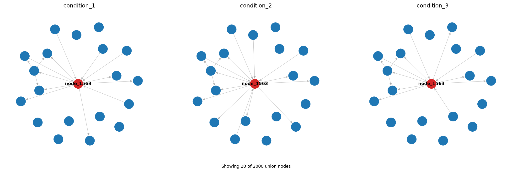

# Large-network plotting example

This example contains three synthetic conditions with **2,000 nodes and 8,000
directed edges per condition**, and 10,983 distinct directed edges across their
union. A changing module and hub make the plotting controls visible. These are
illustrative inputs, not biological data, a cross-implementation validation, or
a p-value benchmark.

## Run the example

From the repository root, create or activate your Python environment, then run:

```bash
cd dynet-py
python -m pip install -e ".[plot]"
python examples/large_network_demo/run_example.py
```

The script writes its outputs beside the example, regardless of your working
directory. The full 2,000-node spring layout is the slowest rendering step.

For an interactive walkthrough, install the notebook interface and launch it
from the same `dynet-py` directory:

```bash
python -m pip install jupyterlab ipykernel
python -m jupyterlab examples/large_network_demo/large_network_demo.ipynb
```

Choose a kernel from the environment where you installed the package, then
select **Restart Kernel and Run All Cells**. The [executed notebook](large_network_demo.ipynb)
includes its tables and plots, so it can also be previewed on GitHub.

## Included views

The example prepares once, calculates sparse rewiring scores for all nodes, and
reuses the same prepared networks and score table for these views:

| View | Plot controls | File |
| --- | --- | --- |
| Full graph with current defaults | `layout="auto"`, automatic labels | [Automatic overview](outputs/01_full_network_auto.png) |
| Full graph with NetworkX positions | `layout="spring"`, no labels | [Spring overview](outputs/02_full_network_spring.png) |
| Highest rewiring scores | `top_n=40`, spring, automatic labels | [Top 40 nodes](outputs/03_top_40_nodes.png) |
| Focused one-hop neighborhood | `focus_node`, `radius=1`, `top_n=25`, selected labels | [Neighborhood](outputs/04_focused_neighborhood.png) |
| Neighborhood across three conditions | `max_nodes=25`, shared positions, focal label | [Comparison panels](outputs/05_neighborhood_comparison.png) |

Filtered views contain only edges between the selected nodes. Their scores and
degrees still describe the full networks, and their color scales use the full
score range. The notebook checks that drawing and filtering do not change scores.

The full network remains dense even with a different layout. Neighborhood and
ranked views provide a smaller set of nodes to inspect. The supplied focal
neighborhood contains 20 nodes:



## Data and reproducibility

The `outputs/` folder includes all three input edge lists, the full 2,000-row
score table, network/view summaries, and metadata with the seed and package
versions. The generator is in [synthetic_networks.py](synthetic_networks.py).
No input download is needed.

Single-run timing observations include layout and PNG saving. They are
illustrative observations from one environment, not benchmark results or
p-value calculation timings. Layouts can vary with library versions; the seed
is fixed to make repeats within an environment reproducible.

Rerunning updates the included output files. Change `N_NODES`, `SEED`, or the
plot controls in the notebook or script to explore other views.
